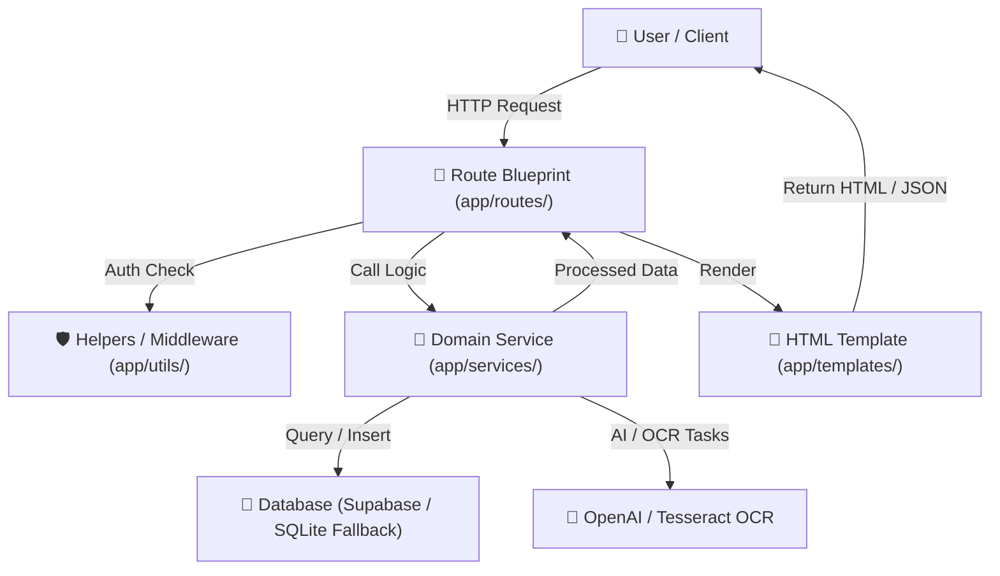

# 📁 Budget Buddy — Project Structure & Architecture Guide

> **Quick Reference**: This document maps the complete file and folder structure of **Budget Buddy**, explaining the purpose and responsibility of each directory and file according to industry-standard architectural patterns.

---

## 🗺️ High-Level Directory Overview

```text
Budget_buddy/
├── 📄 run.py                    # Application entry point (starts development server)
├── 📄 requirements.txt          # Python dependencies
├── 📄 supabase_schema.sql       # PostgreSQL / Supabase database schema
├── 📄 .env.example              # Template for environment configuration
├── 📄 .env                      # Local environment secrets (ignored by Git)
├── 📄 .gitignore                # Git ignore rules
│
├── 📂 app/                      # Main Backend Application (Flask Factory Pattern)
│   ├── 📄 __init__.py           # Creates Flask app & registers Blueprint routes
│   ├── 📄 budget_buddy_local.db # SQLite database file (local-first offline fallback)
│   ├── 📂 routes/               # Presentation Layer: Route Handlers & Controllers
│   ├── 📂 services/             # Business Logic Layer: Data processing, AI & DB
│   ├── 📂 utils/                # Utilities & Middleware (auth wrappers, helpers)
│   ├── 📂 templates/            # UI Layer: Jinja2 HTML Templates
│   └── 📂 static/               # Static Web Assets (CSS stylesheets, images)
│
├── 📂 components/               # React / shadcn UI Component Library
│   └── 📂 ui/                   # Reusable atomic UI primitives (buttons, hero, demo)
├── 📂 lib/                      # Frontend Utility Library (class mergers, helpers)
├── 📂 styles/                   # Frontend Design System (Tailwind tokens & CSS variables)
│
├── 📂 tests/                    # Automated Test Suite (Pytest)
│   ├── 📄 test_routes.py        # HTTP route & authentication tests
│   └── 📄 test_services.py      # Business logic & AI calculation unit tests
│
├── 📄 package.json              # NPM dependencies & build scripts
├── 📄 tsconfig.json             # TypeScript compiler & module alias settings (@/*)
├── 📄 tailwind.config.js        # Tailwind CSS theme & token configuration
├── 📄 postcss.config.js         # PostCSS pipeline settings
└── 📄 components.json           # shadcn UI CLI configuration
```

---

## 🏛️ Layer-by-Layer Breakdown

### 1. ⚙️ Application Root

| File / Folder | Purpose | Description |
|---|---|---|
| [`run.py`](file:///e:/projects/Budget_buddy/run.py) | **Entry Point** | Initializes and runs the Flask application on port `5000`. |
| [`requirements.txt`](file:///e:/projects/Budget_buddy/requirements.txt) | **Python Packages** | Lists required Python libraries (`flask`, `supabase`, `openai`, `pytesseract`, `pandas`, `scikit-learn`, `pytest`). |
| [`supabase_schema.sql`](file:///e:/projects/Budget_buddy/supabase_schema.sql) | **Database Schema** | SQL definitions for tables (`profiles`, `transactions`, `budgets`, `budget_categories`, `savings_goals`). |
| [`.env`](file:///e:/projects/Budget_buddy/.env) | **Configuration** | Environment secrets (Supabase credentials, OpenAI key, Flask secret). |
| [`PROJECT_STRUCTURE.md`](file:///e:/projects/Budget_buddy/PROJECT_STRUCTURE.md) | **Architecture Map** | This structural reference file. |

---

### 2. 🚦 Backend Routes & Controllers (`app/routes/`)

Each file here is a **Flask Blueprint** responsible for receiving HTTP requests, validating input, calling services, and rendering templates or returning JSON responses.

| File | Route Base | Responsibilities |
|---|---|---|
| [`app/routes/auth.py`](file:///e:/projects/Budget_buddy/app/routes/auth.py) | `/`, `/login`, `/register`, `/logout` | User authentication, registration, session management. |
| [`app/routes/dashboard.py`](file:///e:/projects/Budget_buddy/app/routes/dashboard.py) | `/dashboard` | Main student dashboard overview, recent transactions, spending summary. |
| [`app/routes/transactions.py`](file:///e:/projects/Budget_buddy/app/routes/transactions.py) | `/transactions` | Expense/income tracking, manual entry, categorization, editing, deletion. |
| [`app/routes/budget.py`](file:///e:/projects/Budget_buddy/app/routes/budget.py) | `/budget` | Monthly budget planner, category spending limits, adaptive recommendations. |
| [`app/routes/reports.py`](file:///e:/projects/Budget_buddy/app/routes/reports.py) | `/reports` | Monthly trends, category breakdowns, largest expenses, ML predictions. |
| [`app/routes/goals.py`](file:///e:/projects/Budget_buddy/app/routes/goals.py) | `/goals` | Savings target creation, progress tracking, contribution logging. |
| [`app/routes/receipt.py`](file:///e:/projects/Budget_buddy/app/routes/receipt.py) | `/receipt` | Receipt image upload, OCR processing, automatic expense extraction. |
| [`app/routes/ai.py`](file:///e:/projects/Budget_buddy/app/routes/ai.py) | `/coach` | 24/7 AI Financial Coach chat with context-aware financial advice. |
| [`app/routes/simulator.py`](file:///e:/projects/Budget_buddy/app/routes/simulator.py) | `/simulator` | What-If simulation engine testing financial decisions without altering real data. |

---

### 3. 🧠 Business Logic & Data Services (`app/services/`)

Contains pure business logic, calculations, AI integrations, and database operations.

| File | Responsibilities |
|---|---|
| [`app/services/supabase_service.py`](file:///e:/projects/Budget_buddy/app/services/supabase_service.py) | Cloud database client (Supabase PostgreSQL) with automatic local SQLite fallback. |
| [`app/services/local_db.py`](file:///e:/projects/Budget_buddy/app/services/local_db.py) | Embedded SQLite database implementation for zero-config offline mode. |
| [`app/services/ai_service.py`](file:///e:/projects/Budget_buddy/app/services/ai_service.py) | OpenAI GPT integration for expense categorization, receipt parsing, and AI financial coach. |
| [`app/services/analysis_service.py`](file:///e:/projects/Budget_buddy/app/services/analysis_service.py) | Spending aggregation, daily averages, monthly trend analysis using Pandas. |
| [`app/services/budget_service.py`](file:///e:/projects/Budget_buddy/app/services/budget_service.py) | Adaptive budget generation, category limit recommendations, budget risk detection. |
| [`app/services/prediction_service.py`](file:///e:/projects/Budget_buddy/app/services/prediction_service.py) | Month-end spending predictions using statistical extrapolation and ML regression fallback. |
| [`app/services/ocr_service.py`](file:///e:/projects/Budget_buddy/app/services/ocr_service.py) | Tesseract OCR image-to-text extraction from uploaded receipt photos. |

---

### 4. 🎨 Frontend Templates & Views (`app/templates/`)

Jinja2 HTML templates rendering the client-facing user interface:

| Template File | Page Description |
|---|---|
| [`app/templates/base.html`](file:///e:/projects/Budget_buddy/app/templates/base.html) | Global layout shell containing sidebar navigation, user profile widget, and responsive frame. |
| [`app/templates/index.html`](file:///e:/projects/Budget_buddy/app/templates/index.html) | Landing page featuring the animated 4K 3D Financial Hero, feature list, and CTA banner. |
| [`app/templates/login.html`](file:///e:/projects/Budget_buddy/app/templates/login.html) | User login form with email and password authentication. |
| [`app/templates/register.html`](file:///e:/projects/Budget_buddy/app/templates/register.html) | Account creation form with initial monthly income / stipend setup. |
| [`app/templates/dashboard.html`](file:///e:/projects/Budget_buddy/app/templates/dashboard.html) | Overview dashboard with charts, risk alerts, and quick actions. |
| [`app/templates/transactions.html`](file:///e:/projects/Budget_buddy/app/templates/transactions.html) | Transaction ledger with search, category filtering, and add/edit modals. |
| [`app/templates/budget.html`](file:///e:/projects/Budget_buddy/app/templates/budget.html) | Interactive monthly budget builder with adaptive AI suggestions. |
| [`app/templates/reports.html`](file:///e:/projects/Budget_buddy/app/templates/reports.html) | Financial analytics, spending breakdown charts, and forecasting graphs. |
| [`app/templates/goals.html`](file:///e:/projects/Budget_buddy/app/templates/goals.html) | Savings goals visualizer with target milestones and contribution sliders. |
| [`app/templates/receipt.html`](file:///e:/projects/Budget_buddy/app/templates/receipt.html) | Drag-and-drop receipt OCR scanner with instant field preview. |
| [`app/templates/coach.html`](file:///e:/projects/Budget_buddy/app/templates/coach.html) | Interactive AI Financial Coach chat interface. |
| [`app/templates/simulator.html`](file:///e:/projects/Budget_buddy/app/templates/simulator.html) | What-If decision scenario sandbox with live sliders and chart updates. |

---

### 5. 💅 Static Assets (`app/static/`)

| Path | Purpose |
|---|---|
| [`app/static/css/style.css`](file:///e:/projects/Budget_buddy/app/static/css/style.css) | Core CSS stylesheet with layout grids, components, badges, forms, and color themes. |
| [`app/static/images/`](file:///e:/projects/Budget_buddy/app/static/images/) | Image assets, icons, and hero graphics. |
| [`app/static/uploads/`](file:///e:/projects/Budget_buddy/app/static/uploads/) | Temporary receipt uploads directory for OCR processing. |

---

### 6. ⚛️ React & shadcn UI Integration (`components/`, `lib/`, `styles/`)

Modern React + TypeScript + Tailwind component subsystem:

| Path | Purpose |
|---|---|
| [`components/ui/hero-section.tsx`](file:///e:/projects/Budget_buddy/components/ui/hero-section.tsx) | Framer Motion animated `FinancialHero` React component with 3D card physics. |
| [`components/ui/demo.tsx`](file:///e:/projects/Budget_buddy/components/ui/demo.tsx) | Configured showcase component with customized Budget Buddy content and assets. |
| [`components/ui/button.tsx`](file:///e:/projects/Budget_buddy/components/ui/button.tsx) | shadcn UI `Button` primitive using Radix UI `Slot` and Class Variance Authority (`cva`). |
| [`lib/utils.ts`](file:///e:/projects/Budget_buddy/lib/utils.ts) | Export of `cn()` utility function combining `clsx` and `tailwind-merge`. |
| [`styles/globals.css`](file:///e:/projects/Budget_buddy/styles/globals.css) | Tailwind CSS directives & HSL color tokens for dark/light themes. |

---

### 7. 🧪 Test Suite (`tests/`)

| File | Scope |
|---|---|
| [`tests/test_routes.py`](file:///e:/projects/Budget_buddy/tests/test_routes.py) | Tests HTTP responses, page status codes (200 OK), and protected route redirects (302). |
| [`tests/test_services.py`](file:///e:/projects/Budget_buddy/tests/test_services.py) | Unit tests for spending analysis, budget recommendations, risk triggers, and predictions. |

---

## 🔄 Architectural Request Flow



---

## 🚀 Quick Navigation Cheat Sheet

- **Need to add a new page?**
  1. Add a route in [`app/routes/`](file:///e:/projects/Budget_buddy/app/routes/)
  2. Create its template in [`app/templates/`](file:///e:/projects/Budget_buddy/app/templates/)
  3. Link it in sidebar in [`app/templates/base.html`](file:///e:/projects/Budget_buddy/app/templates/base.html)

- **Need to change calculation logic or database queries?**
  - Go to [`app/services/`](file:///e:/projects/Budget_buddy/app/services/)

- **Need to tweak styles or landing page design?**
  - Landing page: [`app/templates/index.html`](file:///e:/projects/Budget_buddy/app/templates/index.html)
  - Global app styles: [`app/static/css/style.css`](file:///e:/projects/Budget_buddy/app/static/css/style.css)
  - React/Tailwind design tokens: [`styles/globals.css`](file:///e:/projects/Budget_buddy/styles/globals.css)
